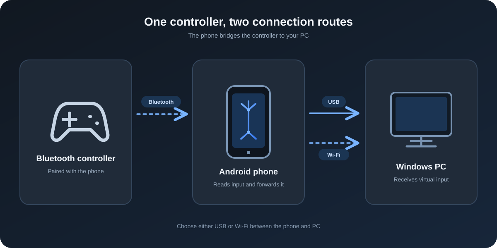
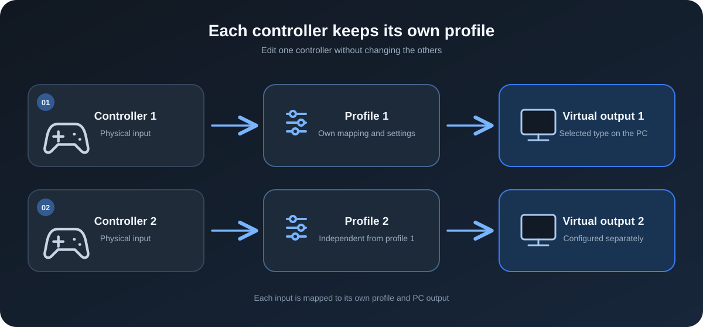
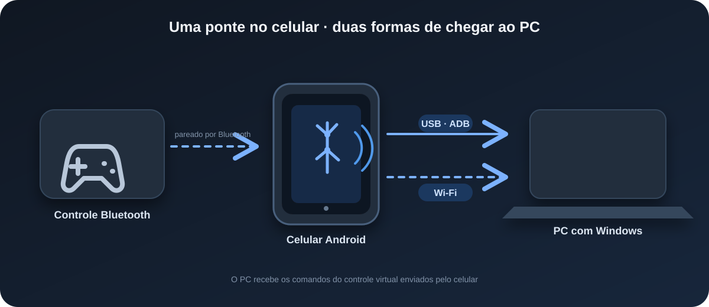
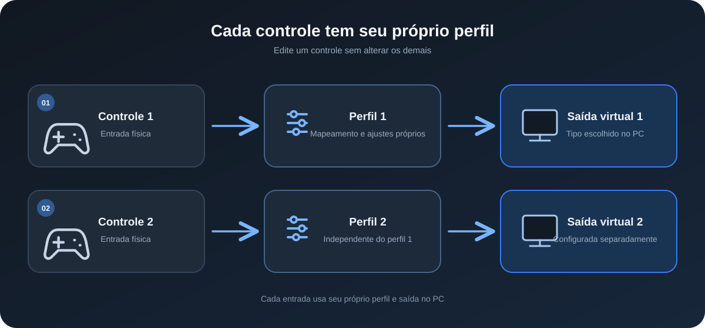

# Controller Bridge

> **100% AI-created project.**

Connect Bluetooth game controllers paired with an Android phone to virtual Xbox 360 or DualShock 4 controllers on Windows 11. The Android app edits profiles and can forward several controllers at once.

## English

### Downloads

- **Android app (APK):** [Download in Portuguese (Brazil)](https://github.com/kauangabrielcardososilva7890-afk/Controller-Bridge/releases/download/v0.5.1/ControllerBridge-Android-PT-BR-v0.5.1.apk) · [Download in English](https://github.com/kauangabrielcardososilva7890-afk/Controller-Bridge/releases/download/v0.5.1/ControllerBridge-Android-EN-v0.5.1.apk)
- **Windows app (ZIP):** [Download in Portuguese (Brazil)](https://github.com/kauangabrielcardososilva7890-afk/Controller-Bridge/releases/download/v0.5.1/ControllerBridge-Windows-PT-BR-v0.5.1.zip) · [Download in English](https://github.com/kauangabrielcardososilva7890-afk/Controller-Bridge/releases/download/v0.5.1/ControllerBridge-Windows-EN-v0.5.1.zip)

Each app package uses a fixed language: PT-BR or EN. The Windows host can still be switched at launch with `--lang en` or `--lang pt`.

### How it works

The controller pairs with Android over Bluetooth. The phone forwards input to the Windows host over USB/ADB for the most direct connection, or over Wi-Fi on the same local network.

Each connected controller gets an independent profile. You can keep automatic mapping or customize buttons and axes, then choose Xbox 360 or DualShock 4 output for that controller.

### Requirements

- Android 8.0 or later with Bluetooth gamepad support.
- Windows 11 x64. The Windows 0.5.1 ZIP includes its private .NET runtime inside one EXE and the official client DLL beside it.
- The official signed ViGEmBus installer and required license notices are included. If the driver is missing, first start asks before opening its visible installer and Windows UAC; cancelling stops startup.
- For USB: a data USB cable and Android USB debugging. Setup finds Android SDK Platform Tools (`adb`) automatically. If missing, it opens Google's official download page for your terms acceptance and asks where you extracted `adb.exe`; SDK tools are not bundled or downloaded silently.

### Install

1. Download and install the Android APK.
2. Pair the PS4, Xbox or another compatible Bluetooth controller with the phone in Android Bluetooth settings.
3. Extract the entire Windows ZIP and open the **ControllerBridge.exe** at the top level. Choose USB (press Enter) or Wi-Fi (type `2`). USB is the default because it usually has lower latency; Wi-Fi shows the PC IP, port **47653**, and pairing code in the dashboard. The private .NET runtime is inside this single EXE. Keep the extracted folders and files beside it; the verified client library, driver setup files and license notices are included. Driver installation is visible and requires your approval.
4. In Android, choose the same connection mode and tap **Connect to PC**. In the PC dashboard, select a controller, choose Xbox 360 or DualShock 4 output, and click a button in the controller diagram to remap it from the phone.

### Connect by USB

1. Enable Android **Developer options** and **USB debugging**. Connect the unlocked phone to the PC and approve the debugging prompt.
2. Start **ControllerBridge.exe** and press Enter for USB (or choose `1`). It locates ADB, asks which phone to use if needed, and prepares USB forwarding automatically. An unauthorized phone stops setup with instructions to approve the PC. Restart the app after changing cables.
3. Keep the Windows window and Android app open; choose **USB · ADB Reverse** on Android and connect. USB uses `127.0.0.1:47652` through the cable, so no PC IP is needed. If ADB is absent, accept the terms and download/extract it from [Google's official Platform Tools page](https://developer.android.com/tools/releases/platform-tools), then select `adb.exe` when setup asks.

### Connect by Wi-Fi

1. Connect the phone and PC to the same local network and open **ControllerBridge.exe**. Type `2` for Wi-Fi; driver setup, if needed, asks for approval first.
2. The PC dashboard shows active IPv4 addresses, port `47653`, and the 32-character pairing code. In the Android app, choose **Wi-Fi**, enter the PC's local IP and the code, then connect.
3. If Windows Firewall asks, allow the app on **private networks only**. The host does not add firewall rules automatically. Keep the pairing code private; Android saves it encrypted in Android Keystore for that PC.

Wi-Fi is convenient but can have more variable latency than USB, depending on the network. The Wi-Fi messages are mutually authenticated and encrypted. The Android and Windows sides must use the same transport. Minimize the dashboard to keep it running in the background; type `stop` or `parar` in the console to stop it. To reset pairing, close the host and delete `%LOCALAPPDATA%\ControllerBridge\pairing.key`, then restart it and enter the new code in Android.

### Features

- Multiple controllers connected to the phone at the same time, each with an independent profile and output selection.
- Windows dashboard with live button highlights, per-controller Xbox 360 / DualShock 4 output selection, and button remapping initiated from the PC.
- Automatic standard mapping, plus individual button remapping, axis reassignment, inversion and calibration.
- Xbox 360 or DualShock 4 virtual output selected per controller.
- Per-profile DS4 motion forwarding toggle when Android exposes compatible controller sensors; the Windows host also exposes motion locally over UDP at `127.0.0.1:26760` for compatible emulator providers. The UDP endpoint starts only while DS4 motion is enabled.
- USB/ADB and opt-in authenticated Wi-Fi transports.
- Conditional DS4 RGB light control: the color picker appears only if Android exposes a controllable RGB light on that DS4. Android 12 or later is required for this public lights API.
- Separate PT-BR and EN Android and Windows downloads. Each Android variant stays in its selected language.

### Current limits

- Keep the Android app open in the foreground while playing; it keeps the screen awake while visible. Background or locked-screen capture is not enabled.
- The Android/DS4 light capability and complete gameplay path still need confirmation on the target phone and controller; unsupported lights are reported and the picker stays hidden.
- The Windows host runs in a terminal window. It does not hide or modify physical controllers connected directly to Windows.
- Xbox virtual devices use Windows XInput slots, shared with physical Xbox-compatible devices.
- Battery reporting, rumble, PS5 output and OTG are not supported.
- ViGEmBus is an external dependency whose upstream repository is archived; review its official releases before installing.

### Build from source

- Android: install Android Studio with the Android SDK and Java 21, then run `product/android-app/Build.ps1`.
- Windows host: install the .NET 8 SDK and run `product/windows-host/Build.ps1`.
- `product/windows-host/Package-Release.ps1` creates self-contained single-file PT-BR/EN Windows ZIPs with the verified official client/driver installer and their license notices. It never runs that installer or publishes a release.

---

## Português

> **Projeto criado 100% com IA.**

Conecte controles Bluetooth pareados com um celular Android a controles virtuais Xbox 360 ou DualShock 4 no Windows 11. O app Android edita perfis e pode encaminhar vários controles ao mesmo tempo.

### Downloads

- **App Android (APK):** [Baixar em português (Brasil)](https://github.com/kauangabrielcardososilva7890-afk/Controller-Bridge/releases/download/v0.5.1/ControllerBridge-Android-PT-BR-v0.5.1.apk) · [Baixar em inglês](https://github.com/kauangabrielcardososilva7890-afk/Controller-Bridge/releases/download/v0.5.1/ControllerBridge-Android-EN-v0.5.1.apk)
- **App Windows (ZIP com EXE):** [Baixar em português (Brasil)](https://github.com/kauangabrielcardososilva7890-afk/Controller-Bridge/releases/download/v0.5.1/ControllerBridge-Windows-PT-BR-v0.5.1.zip) · [Baixar em inglês](https://github.com/kauangabrielcardososilva7890-afk/Controller-Bridge/releases/download/v0.5.1/ControllerBridge-Windows-EN-v0.5.1.zip)

Cada pacote do app usa um idioma fixo: PT-BR ou EN. O host Windows ainda pode ser iniciado com `--lang pt` ou `--lang en` para escolher o idioma.

### Como funciona

O controle é pareado com o Android por Bluetooth. O celular encaminha os comandos ao host Windows por USB/ADB, para a conexão mais direta, ou por Wi-Fi na mesma rede local.

Cada controle conectado recebe um perfil independente. Você pode manter o mapeamento automático ou personalizar botões e eixos, e escolher a saída Xbox 360 ou DualShock 4 para cada controle.

### Requisitos

- Android 8.0 ou superior com suporte a controles Bluetooth.
- Windows 11 x64. O ZIP Windows 0.5.1 inclui o runtime privado do .NET dentro de um EXE e a DLL cliente oficial ao lado dele.
- O instalador oficial assinado do ViGEmBus e os avisos de licença exigidos estão incluídos. Se faltar o driver, a primeira abertura pergunta antes de mostrar seu instalador e o UAC do Windows; cancelar interrompe a abertura.
- Para USB: cabo de dados e depuração USB do Android. A preparação localiza Android SDK Platform Tools (`adb`) automaticamente. Se faltar, ela abre a página oficial da Google para seu aceite dos termos e pede onde você extraiu `adb.exe`; as ferramentas SDK não são incluídas nem baixadas silenciosamente.

### Instalar

1. Baixe e instale o APK Android.
2. Pareie o controle de PS4, Xbox ou outro controle Bluetooth compatível com o celular pelas configurações Bluetooth do Android.
3. Extraia o ZIP Windows inteiro e abra **ControllerBridge.exe** na raiz. Escolha USB (pressione Enter) ou Wi-Fi (digite `2`). USB é o padrão por normalmente ter menos latência; no Wi-Fi, o painel mostra o IP do PC, a porta **47653** e o código de pareamento. O runtime privado do .NET está dentro desse único EXE. Mantenha as pastas e arquivos extraídos ao lado dele; a biblioteca cliente verificada, os arquivos de preparação do driver e os avisos de licença estão incluídos. A instalação do driver é visível e depende da sua confirmação.
4. No Android, escolha o mesmo modo de conexão e toque em **Conectar ao PC**. No painel do PC, selecione o controle, escolha a saída Xbox 360 ou DualShock 4 e clique em um botão do desenho para remapeá-lo pelo celular.

### Conectar por USB

1. Ative **Opções do desenvolvedor** e **Depuração USB** no Android. Conecte o celular desbloqueado ao PC e autorize a solicitação de depuração.
2. Inicie **ControllerBridge.exe** e pressione Enter para USB (ou escolha `1`). Ele localiza ADB, pergunta qual celular usar se necessário e prepara o encaminhamento automaticamente. Um celular não autorizado interrompe a preparação e recebe instruções para autorizar o PC. Reinicie o app após trocar o cabo.
3. Mantenha a janela Windows e o app Android abertos; escolha **USB · ADB Reverse** no Android e conecte. O USB usa `127.0.0.1:47652` pelo cabo, sem precisar do IP do PC. Se faltar ADB, aceite os termos e baixe/extraia-o na [página oficial do Platform Tools da Google](https://developer.android.com/tools/releases/platform-tools); selecione `adb.exe` quando a preparação pedir.

### Conectar por Wi-Fi

1. Conecte o celular e o PC à mesma rede local e abra **ControllerBridge.exe**. Digite `2` para Wi-Fi; se faltar o driver, a preparação pede confirmação antes de instalá-lo.
2. O painel do PC mostra os endereços IPv4 ativos, a porta `47653` e o código de pareamento de 32 caracteres. No app Android, escolha **Wi-Fi**, informe o IP local do PC e o código, e conecte.
3. Se o Firewall do Windows perguntar, permita o programa **somente em redes privadas**. O host não cria regras de firewall automaticamente. Mantenha o código privado; o Android o salva cifrado no Android Keystore para esse PC.

O Wi-Fi é prático, mas pode ter latência mais variável que o USB, dependendo da rede. As mensagens Wi-Fi são autenticadas nos dois sentidos e criptografadas. O Android e o Windows precisam usar o mesmo modo. Minimize o painel para deixá-lo funcionando em segundo plano; digite `stop` ou `parar` no console para encerrar. Para refazer o pareamento, feche o host, apague `%LOCALAPPDATA%\ControllerBridge\pairing.key`, reinicie-o e informe o novo código no Android.

### Recursos

- Vários controles conectados ao celular ao mesmo tempo, cada um com perfil e saída independentes.
- Painel Windows com botões destacados em tempo real, escolha da saída Xbox 360 / DualShock 4 por controle e remapeamento iniciado pelo PC.
- Mapeamento padrão automático, remapeamento individual de botões, troca de eixos, inversão e calibração.
- Saída virtual Xbox 360 ou DualShock 4 selecionada por controle.
- Opção por perfil para encaminhar o movimento do DS4 quando Android expõe sensores compatíveis.
- Conexões USB/ADB e Wi-Fi autenticado opcional.
- Controle condicional da luz RGB do DS4: o seletor de cor aparece somente se Android expuser uma luz RGB controlável nesse DS4. Essa API pública de luzes exige Android 12 ou superior.
- Downloads separados em português e inglês para Android e Windows. Cada variante Android fica fixa no idioma escolhido.

### Limites atuais

- Mantenha o app Android aberto em primeiro plano durante o jogo; ele mantém a tela ligada enquanto está visível. Captura em segundo plano ou com a tela bloqueada não está ativada.
- A disponibilidade da luz no Android/DS4 e o fluxo completo de jogo ainda precisam ser confirmados no celular e controle de destino; quando a luz não é compatível, o app informa e esconde o seletor.
- O host Windows funciona em uma janela de terminal. Ele não oculta nem altera controles físicos conectados diretamente ao Windows.
- Controles virtuais Xbox usam posições XInput do Windows, compartilhadas com controles Xbox físicos compatíveis.
- Bateria, vibração, saída PS5 e OTG não são suportados.
- ViGEmBus é uma dependência externa e o repositório original está arquivado; confira as versões oficiais antes de instalar.

### Compilar do código-fonte

- Android: instale Android Studio com Android SDK e Java 21 e execute `product/android-app/Build.ps1`.
- Host Windows: instale o .NET 8 SDK e execute `product/windows-host/Build.ps1`.
- `product/windows-host/Package-Release.ps1` gera ZIPs Windows autocontidos em arquivo único PT-BR/EN, com cliente e instalador oficiais verificados e os avisos de licença. Ele nunca executa o instalador nem publica uma release.
